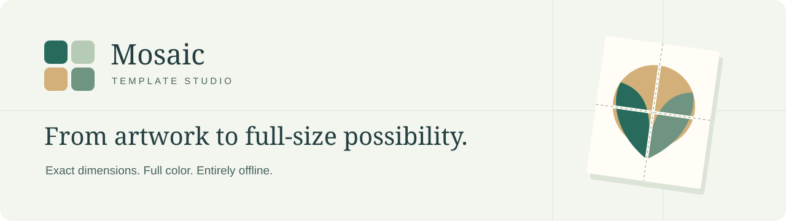
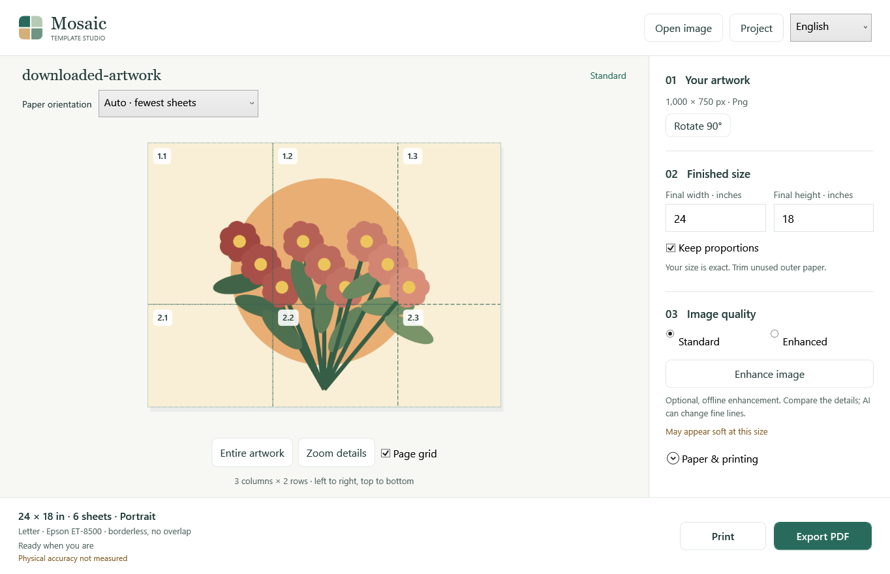
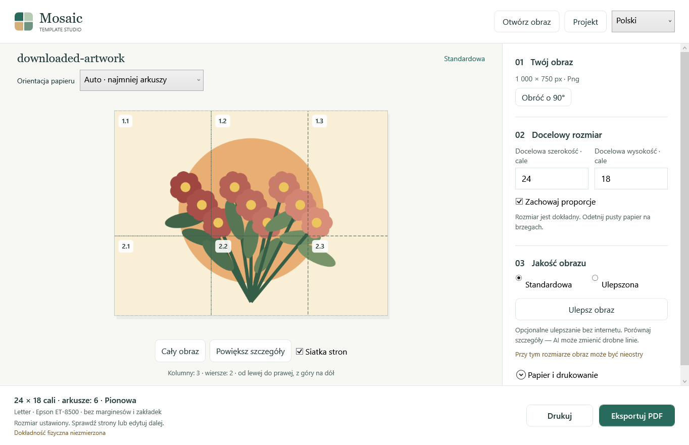

<p align="center"></p>

<p align="center"><strong>Your artwork. Your dimensions. Ready to assemble.</strong><br>A calm, fully offline Windows studio for full-color, life-size mosaic templates.</p>

<p align="center">
<a href="https://github.com/mattkoczwara/template-studio/actions/workflows/checks.yml"></a>
<a href="LICENSE"></a>


</p>

<p align="center"><a href="#get-started">Get started</a> · <a href="#make-your-first-template">How it works</a> · <a href="docs/README.md">Documentation</a> · <a href="CONTRIBUTING.md">Contribute</a></p>

Open an illustration, enter its finished size in inches, and turn it into Letter-size sheets you can join into a paper reference for handmade mosaics. Mosaic preserves the original colors and proportions, with optional local AI enlargement when you want to compare a sharper interpretation.



<p align="center"><sub>Actual WPF editor rendered by the acceptance harness, using a source-generated floral illustration. Grid labels belong to the preview, not the borderless artwork.</sub></p>

## Designed for the workbench

| What matters | What Mosaic does |
|---|---|
| **The size you intended** | Enter inches, keep proportions locked, or choose an exact width and height with Fit, Crop or Stretch. |
| **Straightforward assembly** | Auto chooses the fewest Letter sheets, with portrait on ties. Default tiles have zero duplicated overlap; margins and trim marks are available. |
| **Color worth keeping** | Full-color output by default. Conventional Lanczos enlargement, optional bundled CUNet AI, and an original/enhanced detail comparison. |
| **Two ways to finish** | Direct Windows printing or tiled PDF export from the same physical layout. An assembly guide is optional. |
| **Everything stays local** | No account, telemetry, cloud inference or first-use model download. GPU inference uses Vulkan; a bundled CPU worker provides fallback. |
| **Pick up where you left off** | Portable `.mosaic` projects embed the original image. Recent projects, recovery, undo/redo and English/Polish interfaces support everyday work. |

Everyday 24-inch templates and occasional 60-inch projects use the same layout model. This is an artwork-to-paper tool; it does not segment tesserae, generate cutting paths or turn artwork into a color-by-number pattern.

## Get started

**Requirements:** Windows 10 build 19041 or later, or Windows 11, on x64 hardware. A Vulkan-capable graphics driver enables GPU enhancement; Standard enlargement remains available independently of AI.

**Current distribution:** build from source using the steps below. The repository does not contain a downloadable installer. The build creates a self-contained, bilingual installer with the .NET runtime, decoder, PDF engine, AI workers and model included. No development tools are required on the installed user's computer.

```powershell
git clone https://github.com/mattkoczwara/template-studio.git
cd template-studio
dotnet run --project src/Mosaic.App/Mosaic.App.csproj -c Release
```

Install **.NET SDK 10.0.402** first (see [global.json](global.json)). The first restore needs Internet access; the installed application's core workflow runs offline. To build the installer, also install **Inno Setup 7.1.0**, then run:

```powershell
.\scripts\Build-Release.ps1
```

Find the installer and adjacent SHA-256 file in `artifacts/installer/`. Current builds are **unsigned**. For tool paths, package verification and installation details, see [Windows distribution](docs/DISTRIBUTION.md). Run the generated setup executable, then launch Mosaic Template Studio from Start or the desktop shortcut.

## Make your first template

1. **Open artwork.** Open or drop a JPEG, PNG, WebP or BMP into the editor.
2. **Choose its finished size.** Enter width or height in inches. Proportions stay locked by default; Polish input accepts a decimal comma.
3. **Review the sheets.** Check the preview grid and automatic orientation. Paper and printing settings let you choose margins and the printer profile.
4. **Choose image quality.** Keep Standard, or enhance locally and compare the details. AI can change fine lines; your original stays preserved.
5. **Print or export.** Print PDFs at **Actual size / 100%**. Save a `.mosaic` project with **Ctrl+S** to retain the image and editing settings.

**Before an important print:** use the four-sheet calibration pattern. Epson ET-8500 defaults to color, borderless Letter and zero overlap, but driver expansion can crop seams. Use margin-and-trim when edge-to-edge output is unreliable. Canon MF210 direct printing uses margins and monochrome; nominal PDFs stay color unless grayscale is selected. See [printing and calibration](docs/PRINTING.md).

<details>
<summary><strong>Polski — ten sam projekt, ten sam rozmiar</strong></summary>

Wybierz język polski w nagłówku. Otwórz obraz, podaj docelowy rozmiar w calach (np. `24,5`), sprawdź układ stron i wybierz drukowanie lub eksport PDF. Zapisz projekt `.mosaic`, aby zachować obraz i ustawienia. Plik PDF drukuj w skali **100% / rozmiar rzeczywisty**.



</details>

## Built around one physical layout

```text
Immutable source → Imaging / optional local AI
                           ↓
                 Core · decimal inches
                  ↙        ↓        ↘
              Preview     PDF     Windows print
                           ↕
                 Portable project storage
```

A native **WPF / .NET 10** modular monolith keeps the physical contract in `Mosaic.Core`. PDFsharp reuses and clips image content across pages; Windows print consumes the same immutable layout snapshot. Imaging, project I/O and output work run asynchronously with cancellation. Hash-pinned native workers execute locally, and atomic project/export writes protect existing files.

The [implementation guide](docs/IMPLEMENTATION.md) explains the modules, failure behavior and deliberate departures from the initial architecture recommendation.

## Verification and release status

The implementation has local automated coverage for geometry, independent PDF inspection, XPS preparation, project recovery, real GPU/CPU inference, and rendered EN/PL editor journeys. Historical counts and installer evidence are recorded in the [acceptance map](docs/ACCEPTANCE.md); the CI badge above reports the current hosted subset, **not physical printer certification**.

Physical Epson/Canon ruler and seam measurements, clean offline-machine installation, target-PC artwork/AI evaluation, Windows display scaling, fluent Polish review and independent artist usability remain external acceptance gates. A Windows-accepted print job does not establish paper completion or measured precision.

For a focused local check:

```powershell
dotnet run --project tests/Mosaic.Core.Checks/Mosaic.Core.Checks.csproj -c Release
```

See [contributing](CONTRIBUTING.md) for complete check commands and evidence expectations.

## Explore the project

| Start here | Go deeper |
|---|---|
| [Documentation index](docs/README.md) | [Implemented architecture](docs/IMPLEMENTATION.md) |
| [Printing and calibration](docs/PRINTING.md) | [Image processing and AI provenance](docs/AI.md) |
| [Projects and recovery](docs/STORAGE.md) | [Dependencies and redistribution](docs/DEPENDENCIES.md) |
| [Building and installing](docs/DISTRIBUTION.md) | [Requirements and acceptance](docs/ACCEPTANCE.md) |

Bug reports with reproducible steps and printer/driver details are welcome through [Issues](https://github.com/mattkoczwara/template-studio/issues). Please read [CONTRIBUTING.md](CONTRIBUTING.md) before proposing changes to geometry or output.

## License

Original project code and repository presentation assets are available under the [MIT License](LICENSE). Bundled dependencies, AI model weights and redistributable runtime files retain their respective terms; see [third-party notices](THIRD-PARTY-NOTICES.md) and [dependency licenses](docs/DEPENDENCIES.md). The application grants no rights to imported artwork.
