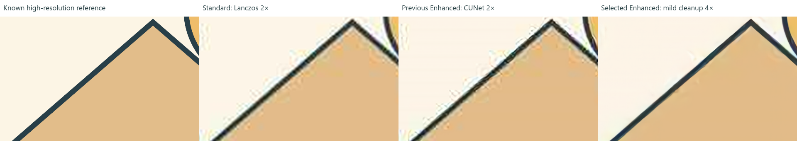
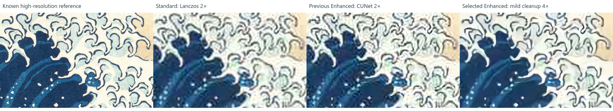

# Enhancement quality evaluation

Completed October 21–22, 2026. The selected recipe is mild-denoise CUNet, repeated twice for eligible small sources to produce 4× output. It visibly reduces JPEG damage and improves contour continuity on the evaluated artwork. It does not recover the lost original texture or guarantee the artist's intended missing detail.

## Matched visual evidence

Every panel below shows the same 480×300-pixel reference-space region at the same display scale: known high-resolution reference, Standard, previous Enhanced, selected Enhanced. The synthetic crop starts at (1,382,367); the scanned crop at (819,250), on 2,560×1,672 canvases.





The selected recipe cleans the house's JPEG halos and blocking while retaining its contour and fill colors. On the woodblock it reduces distracting compression noise, but also smooths paper texture and some thin details. These are cleanup and inferred contour improvements, not a claim that all lost detail was reconstructed. Standard remains the default and provides immediate reversion.

## Evaluation method and measurements

The reproducible set contains three 320×209 fixtures—clean vector-like shapes, fine linework, and degraded linework—a full-canvas 640×418 compressed illustration, and a real 640×418 woodblock scan. The deterministic synthetic references are drawn at 4× source dimensions. Degraded inputs use Lanczos downsampling, sigma-0.3 blur, JPEG quality 40 and 2×2 chroma subsampling. The scanned reference is a center crop of The Met's high-resolution image, resized to 2,560×1,672 before degradation.

Standard is Lanczos 2× followed by Lanczos to the common 4× comparison canvas; 2× AI results receive the same final resampling. All methods therefore have identical comparison dimensions and nominal physical size. At 24 inches wide, a 640-pixel source supplies 26.7 source pixels/inch and a 4× output 106.7 pixels/inch; these figures describe sampling density, not recovered detail or measured print accuracy.

Each cell below is **PSNR dB / block SSIM**; higher is better. PSNR is `20 log10(1/RGB RMSE)`. Block SSIM averages luminance SSIM over nonoverlapping 8×8 blocks, using sample variance and conventional 8-bit constants 6.5025/58.5225. This explicitly defined metric is not interchangeable with Gaussian-window SSIM. Flat regions influence scores, so the matched crops were also visually inspected.

| Fixture | Standard | Previous CUNet 2× | Pure CUNet 4× | Selected mild CUNet 4× |
|---|---|---|---|---|
| Clean vector, 320×209 | 25.52 / .8908 | 30.00 / .9642 | 33.13 / .9882 | **34.76 / .9901** |
| Fine linework, 320×209 | 22.18 / .7826 | 25.48 / .9061 | **30.82 / .9735** | 30.55 / .9731 |
| Degraded linework, 320×209 | 19.85 / .7241 | 20.38 / .7568 | 20.43 / .7609 | **22.30 / .8646** |
| Compressed illustration, 640×418 | 25.25 / .8817 | 25.87 / .8878 | 25.94 / .8874 | **29.58 / .9649** |
| Scanned woodblock, 640×418 | 22.65 / .5743 | 22.63 / .5734 | 22.55 / .5719 | **23.94 / .6211** |

The corrected compressed illustration improves by **3.71 dB** over the previous Enhanced result. Pure 4× scaling alone adds only 0.07 dB there: mild restoration, rather than extra pixels, supplies the useful gain. Fine clean strokes slightly favor pure CUNet 4×; the difference was small enough to retain one simple recipe because compressed artwork benefited substantially.

The initial synthetic 640 fixture had unscaled drawing coordinates and a blank inspection crop. **Its initial visual-quality claims and numerical scores were withdrawn.** The generator now scales the complete illustration into the reference canvas. Only the corrected 640 measurements above are used. The 320 fixtures and real scan were unaffected.

## Alternatives and selection

The bounded initial evaluation also tested mild CUNet 2×, denoise-first/pure-second CUNet 4×, RealESRGAN anime-video 4× and RealESRGAN anime 6B 4×. The latter two are suitable illustration candidates, not generic photo sharpening presets. On valid fixtures:

| Candidate | Clean vector | Fine linework | Degraded linework | Scanned woodblock |
|---|---|---|---|---|
| Mild CUNet 2× | 29.78 / .9637 | 25.37 / .9066 | 21.72 / .8407 | 23.90 / .6192 |
| Denoise-first/pure-second 4× | 33.98 / .9890 | 29.77 / .9687 | 22.36 / .8659 | 23.94 / .6211 |
| RealESRGAN anime-video 4× | 26.35 / .9610 | 23.51 / .9019 | 21.12 / .8710 | 22.67 / .6137 |
| RealESRGAN anime 6B 4× | 24.92 / .9521 | 23.30 / .9319 | 20.26 / .9044 | 21.00 / .5933 |

The RealESRGAN models were rejected despite some favorable structural scores. Visual inspection showed changed contour character, oversharp/darker lines, color simplification and loss of paper variation. The 6B model turned scanned wave contours into thin, nearly black outlines. These changes are unsuitable when an artist needs faithful template contours. The hybrid CUNet recipe supplied no compelling overall gain over repeating the same mild model. Upstream source confirms `-n 1 -s 4` applies the same configured model in both 2× passes.

The selected method retains the current native inference architecture, Vulkan/NVIDIA path and isolated CPU adapter. No new runtime or dependency was selected. Application resource caps determine when only one 2× pass is allowed; this report's selected 4× metrics concern eligible small sources.

## Production consistency and resource evidence

Fresh application-service runs on the **corrected** 640×418 JPEG produced 2,560×1,672 assets on both backends. GPU: **3.15 seconds, 161.4 MiB** sampled peak worker host memory. CPU: **17.34 seconds, 118.9 MiB**. RMSE to the selected official native candidate was .00234 GPU / .00392 CPU. The native benchmark decodes JPEG directly, whereas the application imports to its normalized PNG, so bit identity is not expected. Checksum-preserving cache reuse passed on both backends.

For the same corrected source, selected native inference alone took 1.69 seconds and 159.2 MiB worker host memory. These are machine/run-specific observations, excluding quality scoring, and are not VRAM measurements or latency promises. Earlier valid candidate runs used roughly 240–258 MiB for anime-video and 474–491 MiB for anime 6B, compared with 147–161 MiB for CUNet.

The earlier production run is retained separately in ignored artifacts: GPU 2.66 seconds, CPU 47.40 seconds. Its sampled memory was read after cache diagnostics reset and is unavailable. The corrected run captures memory before cache reuse. Different input coverage and concurrent machine load mean these timings are not a controlled performance comparison.

## Provenance and reproduction

- CUNet models and GPU worker: [official Windows 20250915 release](https://github.com/nihui/waifu2x-ncnn-vulkan/releases/tag/20250915). Archive SHA-256 `7425be94b94e4c8f37a1e433ac0e0100c43790e2c37418f4b65d8235adfbdc87`. Both [worker](https://github.com/nihui/waifu2x-ncnn-vulkan/blob/master/LICENSE) and [model project](https://github.com/nagadomi/waifu2x/blob/master/LICENSE) use MIT; existing bundled notices apply. Mild-denoise weights are from that same archive and are independently pinned in the application manifest.
- Evaluation-only RealESRGAN models: [official v0.2.5.0 / Windows 20220424 bundle](https://github.com/xinntao/Real-ESRGAN/releases/tag/v0.2.5.0), archive SHA-256 `abc02804e17982a3be33675e4d471e91ea374e65b70167abc09e31acb412802d`. The [NCNN adapter is MIT](https://github.com/xinntao/Real-ESRGAN-ncnn-vulkan/blob/master/LICENSE); the [model project is BSD 3-Clause](https://github.com/xinntao/Real-ESRGAN/blob/v0.2.5.0/LICENSE). These candidates remain outside the installer.
- Real-art reference: Hokusai's [Under the Wave off Kanagawa, Met object 45434](https://www.metmuseum.org/art/collection/search/45434), marked Public Domain. The [Met Open Access policy](https://www.metmuseum.org/hubs/open-access) releases these images under CC0. Source-image SHA-256 `cbb9988f2f18b9180a1cc0cf5dbb0e3bbf8f2e85d17930cf6ca9ab36fac36303`.

Run `scripts/Acquire-QualityCandidates.ps1`, then the repository SDK with:

```powershell
.tools/dotnet/dotnet.exe run --project tests/Mosaic.Quality.Checks -c Release -r win-x64 -- --corrected-640 --finalists --fresh
.tools/dotnet/dotnet.exe run --project tests/Mosaic.Quality.Checks -c Release -r win-x64 -- --real-only --finalists --reuse
.tools/dotnet/dotnet.exe run --project tests/Mosaic.Quality.Checks -c Release -r win-x64 -- --production
.tools/dotnet/dotnet.exe run --project tests/Mosaic.Quality.Checks -c Release -r win-x64 -- --evidence
```

Without a fixture filter the harness regenerates the synthetic set; omitting `--finalists` enables the original eight candidates. `--reuse` verifies recorded input/output SHA-256 identity; a changed fixture forces inference. Reused inference timings and memory are `null`, never a misleading near-zero benchmark. Reuse is intended for rescoring unchanged model assets. Raw JSON/crops remain in ignored `artifacts/quality`; the compact evidence record is checked in beside this report's images.

This small known-reference set establishes useful deblocking/contour gains, not universal enhancement or recovery of irretrievable texture. The target artist's corpus, perceptual preferences and physical printer behavior remain empirical acceptance boundaries. Pipeline, UI, packaging and geometry regression checks are documented separately in [AI.md](AI.md).
